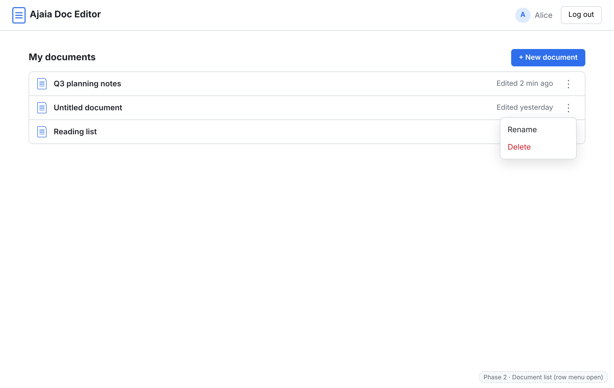
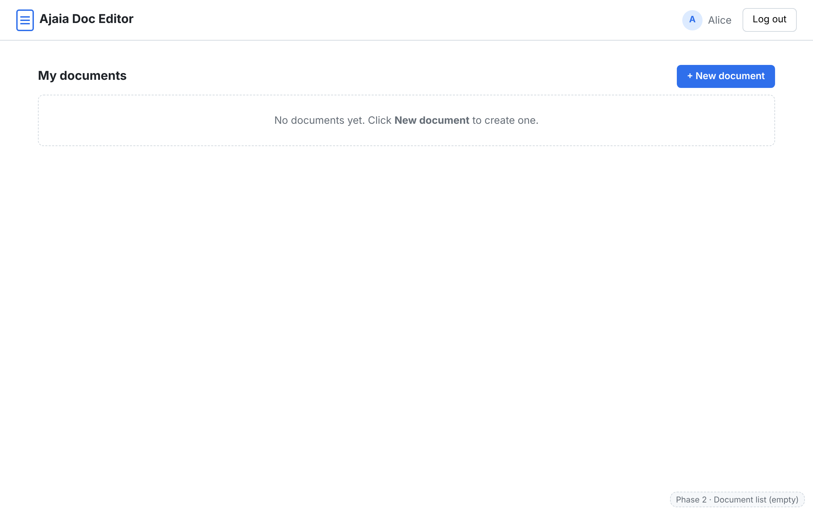
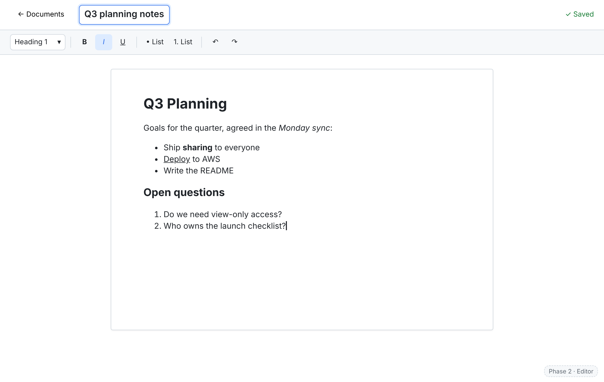
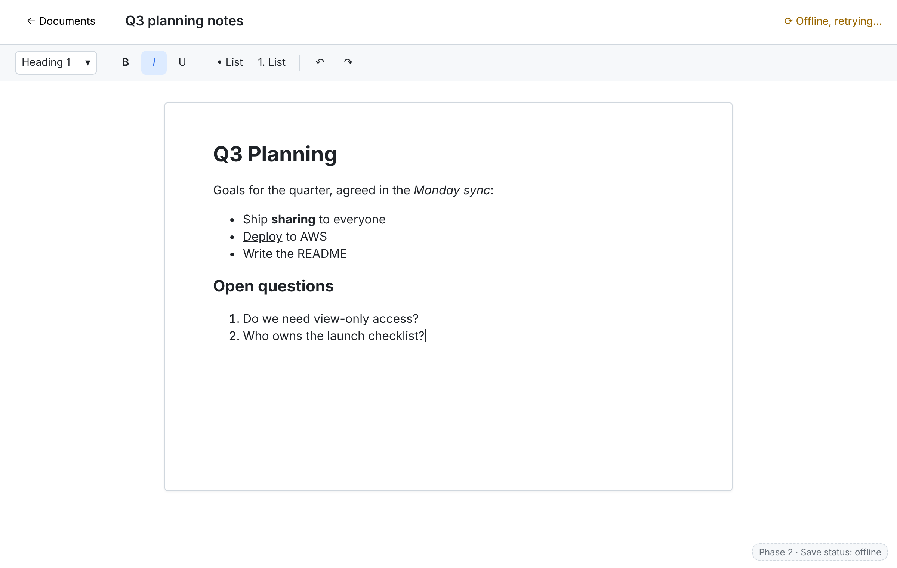
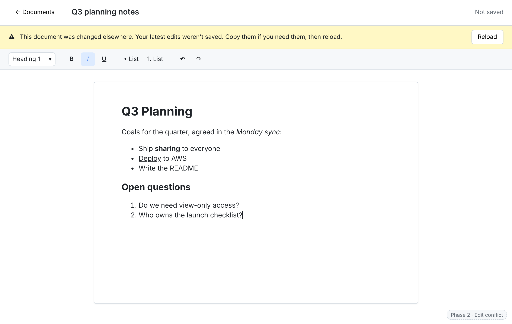

# Phase 2: Documents + editor

**Goal:** a logged-in user can create a document, rename it, format text, have it autosave, and reopen it later. Documents are private to their owner in this phase.

## Summary (1-2 min read)

**What you get:** a "My documents" list with a New document button. Each doc opens in a Tiptap editor with a toolbar for bold, italic, underline, H1-H3 and bulleted/numbered lists. Click the title to rename it. Changes autosave and the header shows Saving… / Saved / Offline, retrying. Close the tab, come back, and everything is still there.

**How it's built:**

- A `documents` table stores the title and the content as Tiptap JSON (`jsonb`), never HTML.
- The server checks every save against the same editor schema the browser uses and rejects anything unknown, so stored content can't carry scripts.
- Autosave fires 1 second after you stop typing (at least every 5 seconds while typing).
- Each save sends a version number. If someone else saved first (possible once sharing exists), you get a "changed elsewhere, reload" banner instead of silently overwriting their work.
- If you don't own a doc, the API answers 404 as if it doesn't exist.

**Deliberately not included:** sharing, upload, comments, version history, images, tables, links.

**Decided:** owners can delete their own docs (with a confirm dialog), even when shared. Nobody else can.

---

## Scope

document list (owned docs), create, rename, open, Tiptap editor with toolbar, debounced autosave, save status, version conflict check, owner-only delete _(default, see open questions)_.

## Out of scope

Sharing (Phase 3), upload (Phase 4), comments, version history, images, tables, links.

## Database

```sql
documents (
  id          uuid primary key default gen_random_uuid(),
  owner_id    uuid not null references users(id) on delete cascade,
  title       text not null default 'Untitled document',  -- max 200 chars
  content     jsonb not null,           -- Tiptap/ProseMirror JSON
  version     integer not null default 1,
  created_at  timestamptz not null default now(),
  updated_at  timestamptz not null default now()
)
index on documents(owner_id, updated_at desc)
```

## API

| Method | Route                | Who        | Notes                                                   |
| ------ | -------------------- | ---------- | ------------------------------------------------------- |
| GET    | `/api/documents`     | logged in  | owned docs, newest first (no content)                   |
| POST   | `/api/documents`     | logged in  | creates empty doc, returns it                           |
| GET    | `/api/documents/:id` | has access | title, content, version                                 |
| PATCH  | `/api/documents/:id` | has access | `{title?, content?, version}` → 409 if version is stale |
| DELETE | `/api/documents/:id` | owner      |                                                         |

**Access check:** one helper, `getAccessibleDoc(userId, docId)`, used by every `:id` route. In this phase it means "owner". Phase 3 widens it to "owner or granted". No access returns **404**, not 403, so IDs don't reveal that a doc exists.

**Content validation:** the server parses incoming JSON with ProseMirror's `Node.fromJSON` using the shared editor schema. Unknown nodes, marks or attributes are rejected with 400. Body limit 1 MB. We never store or render raw HTML.

## Editor

Tiptap with only what we need: paragraph, heading (H1-H3), bold, italic, underline, bullet list, numbered list, hard break, undo/redo. Standard shortcuts work (Ctrl/Cmd+B, I, U, Z). Markdown-style input rules (`# `, `- `, `1. `) come free with Tiptap.

## Autosave

- Save 1 s after typing stops, and at least every 5 s while typing continues.
- Title saves on blur / Enter.
- Status in the header: **Saving…** → **Saved** → **Offline, retrying** (exponential backoff).
- On tab close with unsaved changes: one last `fetch(..., {keepalive: true})` plus the browser "leave page?" prompt.
- **Conflict:** each save sends the `version` it was based on. If someone else saved in between (possible after Phase 3), the server returns 409 and the editor shows a banner: _"This document was changed elsewhere. Reload to see the latest version."_ Your unsaved text is kept in the editor so you can copy it. Simple, and nothing gets silently overwritten.

## Wireframes

Rendered mockups. The layout and wording are what I'll build; colors and spacing may shift slightly.

**Document list, with a row's menu open**



**Empty list**



**Editor (title focused for renaming)**



**Save status while the server is unreachable**



**Edit conflict banner**



## Testing

API tests: create/list/get/patch; another user gets 404 on every route; invalid content rejected; stale version → 409. One Playwright smoke test: log in, create doc, type, reload, text is still there.

## Open questions

- ~~**Delete:** include owner-only delete?~~ **Decided (Nick):** yes. Only the owner can delete, even when the doc is shared. Deleting a shared doc removes it for everyone it was shared with.
- ~~**Trash/undo delete:**~~ **Decided (Nick):** no. A confirm dialog is enough.

## Acceptance criteria

- [ ] `npm test` passes, including an API suite that, as alice (owner) vs bob (stranger), checks every `/api/documents/:id` route: owner → 2xx, bob → 404
- [ ] `curl -b alice POST /api/documents` → 201; `GET /api/documents` lists it; `PATCH` with `{title:"X", version:1}` → 200 with `version: 2`
- [ ] `PATCH` again with `version: 1` → 409
- [ ] `PATCH` with content containing an unknown node (e.g. `{"type":"script"}`) or an unknown mark → 400; a 2 MB body → 413
- [ ] `PATCH` with a body containing `owner_id` or `userId` → ignored (owner unchanged in `psql`)
- [ ] `DELETE` as owner → 204, then `GET` → 404
- [ ] Playwright: log in, create doc, apply bold, italic, underline, H1, bulleted and numbered list, wait for "Saved", reload → identical content and formatting
- [ ] Playwright: stop the server container → status shows "Offline, retrying"; start it → returns to "Saved" with no lost text
- [ ] Playwright: rename from the list and from the editor header, both persist after reload
