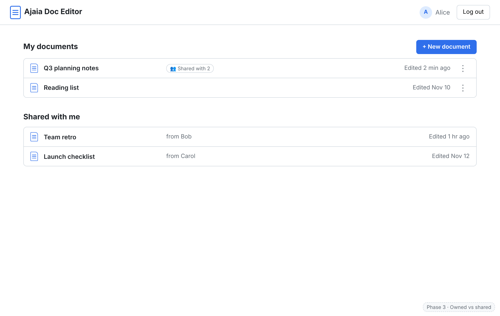
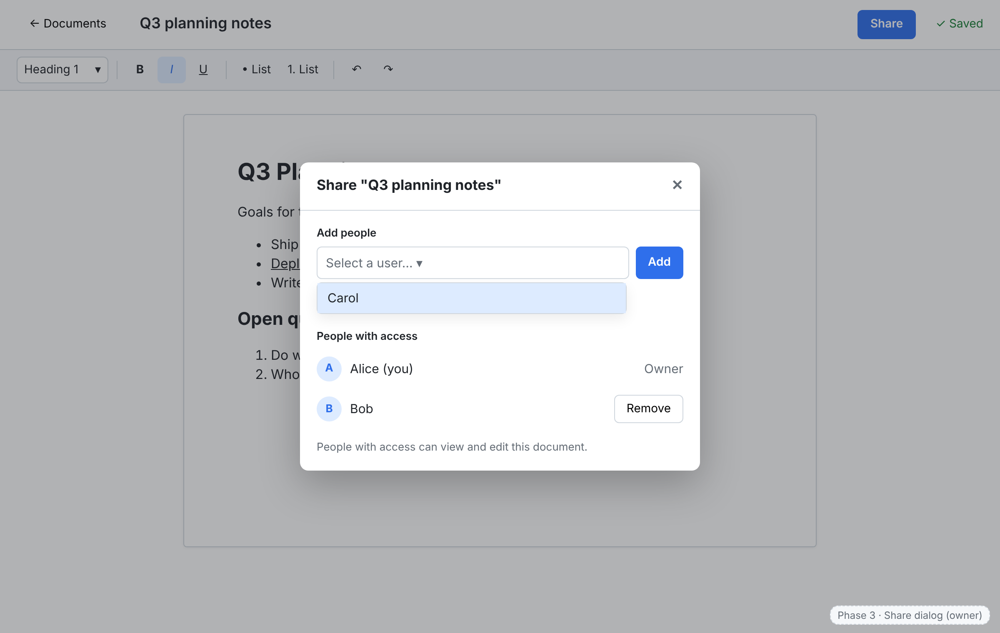
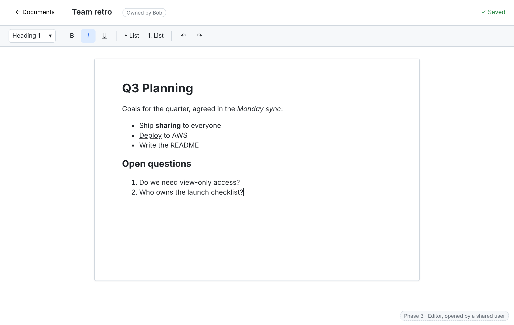
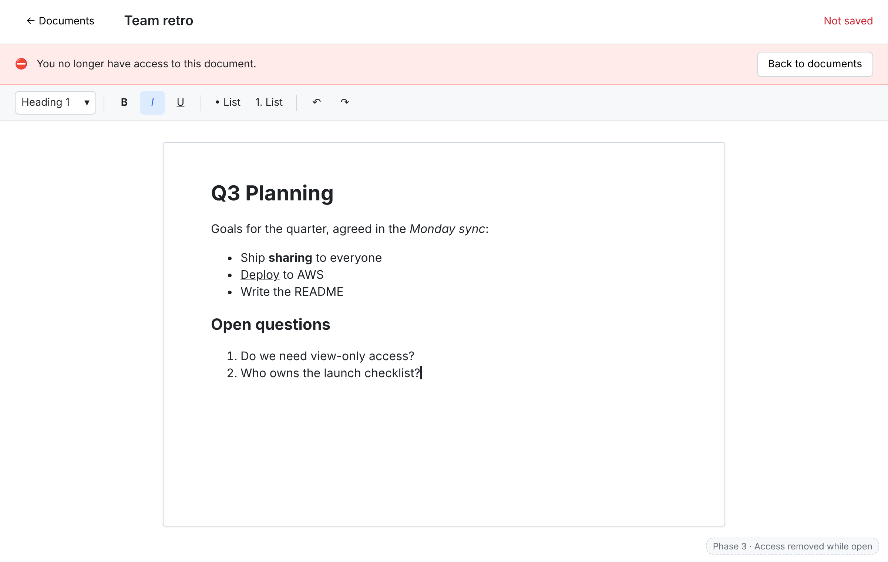

# Phase 3: Sharing

**Goal:** an owner can give another user access to a document. Access means read + edit. The list clearly separates docs you own from docs shared with you.

## Summary (1-2 min read)

**What you get:** a Share button (owner only) opens a dialog where you pick a user and add or remove them. Anyone you share with can open and edit the doc. The list now has two sections, **My documents** and **Shared with me**, and shared docs show who owns them.

**How it's built:**

- A `document_access` table records who was given access to which doc.
- The access check from Phase 2 widens from "owner" to "owner or given access". It's one helper used by every route, so there's a single place to get it right.
- Only the owner can share, unshare or delete. Shared users get 403 if they try, and everyone else still gets 404.
- If access is removed while someone has the doc open, their next save fails and they see "You no longer have access."
- Two people editing at the same time is handled by Phase 2's version check.

**Deliberately not included:** view-only or comment levels, share links, notifications, transferring ownership.

**Decision for you:** can shared users rename a doc? I'll say yes (renaming counts as editing) unless you prefer owner-only.

---

## Scope

grant and revoke access, share dialog, "Shared with me" section, access checks widened to "owner or granted".

## Out of scope

Permission levels (view-only, comment), share links, sharing with people outside the seeded users, notifications, transferring ownership.

## Database

```sql
document_access (
  document_id  uuid references documents(id) on delete cascade,
  user_id      uuid references users(id)     on delete cascade,
  granted_by   uuid references users(id),
  created_at   timestamptz not null default now(),
  primary key (document_id, user_id)
)
index on document_access(user_id)
```

## Rules

| Action                | Owner | User with access   | Anyone else |
| --------------------- | ----- | ------------------ | ----------- |
| Open, edit content    | ✓     | ✓                  | 404         |
| Rename                | ✓     | ✓ _(default)_      | 404         |
| See who has access    | ✓     | ✓ (read-only list) | 404         |
| Grant / revoke access | ✓     | ✗ (403)            | 404         |
| Delete document       | ✓     | ✗ (403)            | 404         |

- An owner can't share with themselves; sharing twice is a no-op.
- Revoking takes effect on the next request. If the revoked user has the doc open, their next save gets 404 and the editor shows _"You no longer have access to this document."_
- Two people editing at once is handled by the Phase 2 version check (409 + reload banner).

## API

| Method | Route                               | Who                                                                                          |
| ------ | ----------------------------------- | -------------------------------------------------------------------------------------------- |
| GET    | `/api/documents`                    | logged in → now returns `{ owned: [...], shared: [...] }`; shared items include owner's name |
| GET    | `/api/users`                        | logged in → `id, username, displayName` for the share picker                                 |
| GET    | `/api/documents/:id/access`         | owner or access                                                                              |
| POST   | `/api/documents/:id/access`         | owner → `{ userId }`                                                                         |
| DELETE | `/api/documents/:id/access/:userId` | owner                                                                                        |

`getAccessibleDoc` becomes one SQL query (`owner_id = $user OR EXISTS access row`) and also returns the caller's role (`owner` / `editor`), so routes can check ownership without a second query.

Listing all users is fine here because users are a small seeded set. With real sign-up, this would become search-by-exact-username.

## Wireframes

Rendered mockups. The layout and wording are what I'll build; colors and spacing may shift slightly.

**Owned vs shared documents**



**Share dialog (owner only)**



**Editor opened by someone it was shared with (no Share or Delete)**



**Access removed while the doc is open**



## Testing

API matrix test covering every row of the rules table for owner, granted user and stranger. Revoke-while-open test. Playwright: Alice shares with Bob, Bob logs in and edits, Alice reopens and sees Bob's change.

## Open questions

- **Can shared users rename?** _Default: yes._
- **Can a shared user remove themselves ("leave")?** _Default: no, keep it simple._

## Acceptance criteria

- [ ] `npm test` passes, including a matrix test covering every cell of the rules table for owner (alice), granted user (bob) and stranger (carol), with the exact status codes listed
- [ ] `curl -b alice POST /api/documents/:id/access -d '{"userId":"<bob>"}'` → 201; repeating it → 200 no-op; sharing with alice herself → 400
- [ ] `curl -b bob GET /api/documents` → doc appears under `shared` with `ownerName: "Alice"`, not under `owned`
- [ ] `curl -b bob POST .../access` and `DELETE /api/documents/:id` → 403; `curl -b carol GET /api/documents/:id` → 404
- [ ] Revoke: alice `DELETE .../access/<bob>` → bob's next `PATCH` → 404
- [ ] Concurrent edit: alice and bob both `PATCH` from version N → one 200, one 409
- [ ] Playwright: alice shares with bob → bob logs in, sees it under "Shared with me", edits → alice reopens and sees bob's change
- [ ] Playwright: as bob, the editor has no Share or Delete controls and shows "Owned by Alice"
