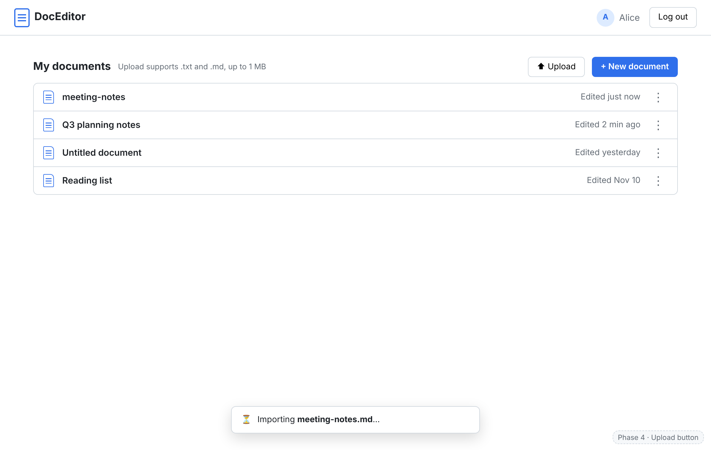
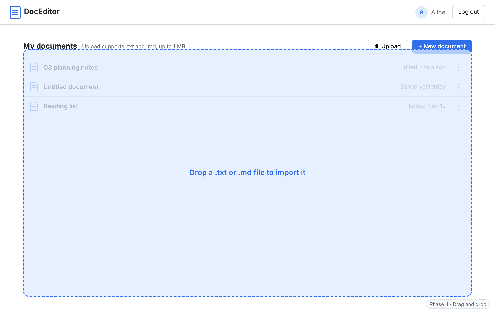
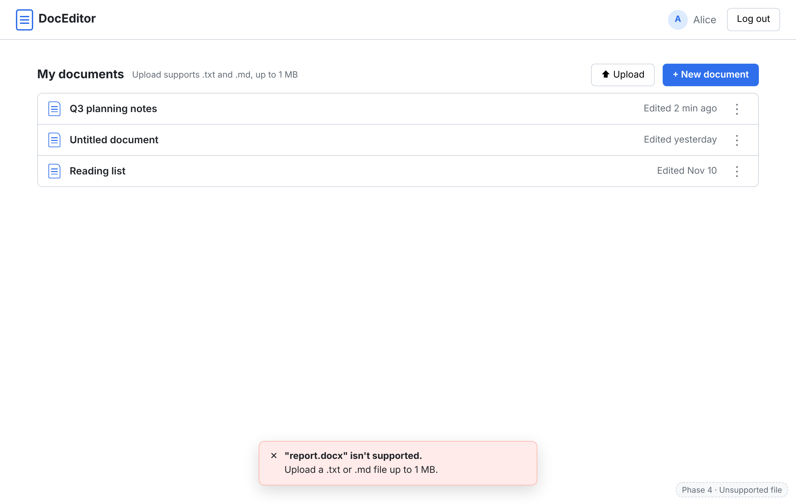
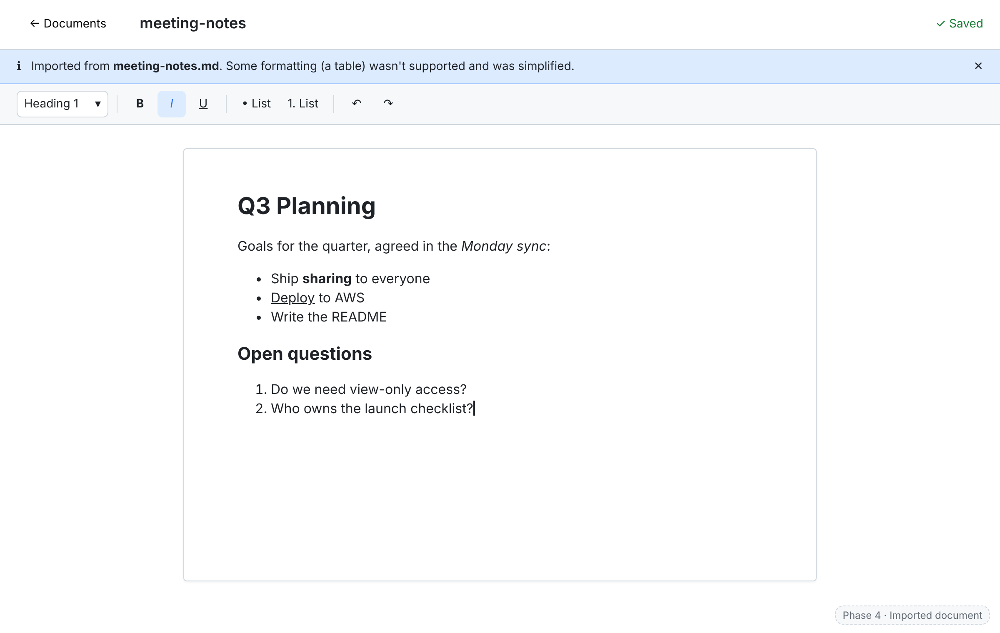

# Phase 4: Upload `.txt` / `.md`

**Goal:** a user uploads a `.txt` or `.md` file and it becomes a new document they own, which they can edit like any other.

## Summary (1-2 min read)

**What you get:** an Upload button on the document list (drag and drop works too), labelled "Supports .txt and .md, up to 1 MB". The uploaded file becomes a new document you own and opens straight in the editor.

**How it's built:**

- The file goes to the server, which checks the type and size and rejects anything that isn't real text.
- After conversion, the new document must also fit the normal document size limit (the same one every save uses). Converted JSON is larger than the raw text, so a file just under 1 MB can be rejected with a clear "too large once converted" message. This means an uploaded doc can always be edited and saved afterwards.
- Markdown is converted with markdown-it, with raw HTML turned off, then into Tiptap JSON. Plain text becomes paragraphs.
- The result passes the same schema check as normal saves, so an upload can't sneak in anything the editor wouldn't allow.
- Markdown features the editor doesn't support are simplified, not lost silently. Tables become text, H4-H6 become H3, and images are dropped. A note tells you when this happened.
- Wrong type, too large and binary files each get a clear error message.

**Deliberately not included:** `.docx` (stretch goal), PDF, HTML, importing into an existing doc, bulk upload.

**Decision for you:** none. This phase follows what we already agreed.

---

## Scope

`.txt` and `.md`, up to 1 MB, one file at a time; supported types stated in the UI and README.

## Out of scope

`.docx` (stretch, via mammoth.js), `.pdf`, `.html`, images, importing into an existing doc, bulk upload.

## How it works

```text
browser ──multipart──▶ POST /api/documents/import
                          │ 1. check extension (.txt/.md) and size ≤ 1 MB
                          │ 2. decode as UTF-8; reject binary (NUL bytes / invalid UTF-8)
                          │ 3. convert
                          │      .md  → markdown-it (html: false) → HTML → Tiptap JSON
                          │      .txt → paragraphs split on blank lines,
                          │             single newlines become line breaks
                          │ 4. validate against the shared editor schema (same as Phase 2)
                          │ 5. check the converted JSON fits the normal save limit, else 413
                          │ 6. insert document, owner = session user
                          ▼
                       201 { id }  → browser opens /d/:id
```

- **Conversion happens on the server**, using Tiptap's server-side `generateJSON` with the same extension list as the editor. Stored content is always valid editor JSON.
- **`html: false` in markdown-it** means raw HTML inside markdown is treated as text, never executed. The schema step is a second safety net.
- **Title** = filename without extension (e.g. `meeting-notes.md` → "meeting-notes"), trimmed and cut to the normal 200-character title limit. An empty name becomes "Untitled document".
- **Size limits match normal documents.** A normal save can be at most 1 MB of JSON (title + content), and a title at most 200 characters. The 1 MB file check runs first to reject big files cheaply. The converted content is then checked against the save limit, using one shared constant with a little room left for the title and version. Without this, an upload could create a document whose every later save fails with 413.
- **Lossy by design:** markdown features the editor doesn't support are simplified. H4-H6 → H3, code blocks and blockquotes → paragraphs, tables → text, links → link text, images → dropped. The upload response includes a `warnings` count, and the UI shows _"Some formatting wasn't supported and was simplified."_
- multer with memory storage and a 1 MB limit. Nothing is written to disk.

## API

| Method | Route                   | Notes                                                                                |
| ------ | ----------------------- | ------------------------------------------------------------------------------------ |
| POST   | `/api/documents/import` | multipart field `file`. 201 `{id, warnings}` · 400 bad type/encoding · 413 too large |

## Wireframes

Rendered mockups. The layout and wording are what I'll build; colors and spacing may shift slightly.

**Upload button and supported types, import in progress**



**Drag and drop**



**Unsupported file**



**Imported document with the simplification note**



## Testing

Every conversion rule gets its own fixture file in `server/test/fixtures/import/` and a test that checks the **exact** stored Tiptap JSON, so what is kept, changed or dropped is pinned down. Each fixture also runs through the real upload endpoint once, so the API and the converter can't drift apart.

**Markdown: kept as-is**

| Input                                          | Expected result                                    |
| ---------------------------------------------- | -------------------------------------------------- |
| `# H1`, `## H2`, `### H3`                      | headings level 1, 2, 3                             |
| `**bold**`, `*italic*`, `__bold__`, `_italic_` | bold / italic marks                                |
| `***both***`                                   | text with both bold and italic                     |
| `- a` / `* a` / `+ a` lists                    | bullet list                                        |
| `1. a` / `3. a` lists                          | numbered list (start number not kept, noted below) |
| nested bullets inside numbered and the reverse | nested lists at the same depth                     |
| paragraphs separated by blank lines            | one paragraph each                                 |
| hard line break (two trailing spaces or `\`)   | line break inside the paragraph                    |

**Markdown: simplified (warning shown)**

| Input                     | Expected result                                         |
| ------------------------- | ------------------------------------------------------- |
| `####`, `#####`, `######` | heading level 3, same text                              |
| fenced and indented code  | plain paragraph(s) with the code text, line breaks kept |
| `` `inline code` ``       | plain text `inline code` (backticks removed)            |
| `> quote`                 | plain paragraph with the quote text                     |
| `[text](https://x.com)`   | `text` only, no link                                    |
| ``         | dropped entirely                                        |
| table                     | one paragraph per row, cells separated by `\|`          |
| `~~strike~~`              | `strike` as plain text                                  |
| `---` horizontal rule     | dropped                                                 |
| task list `- [ ] todo`    | bullet item with text `[ ] todo`                        |
| `3.` numbered list start  | list starts at 1                                        |

Each simplified case asserts `warnings > 0`. A file with only supported features asserts `warnings: 0`.

**Markdown: safety**

| Input                                      | Expected result                                  |
| ------------------------------------------ | ------------------------------------------------ |
| `<script>alert(1)</script>`                | literal text, no script node                     |
| ``             | literal text                                     |
| `<u>under</u>` (markdown has no underline) | literal text `<u>under</u>`                      |
| `<b>bold?</b>`                             | literal text `<b>bold?</b>`, not bold            |
| `[x](javascript:alert(1))`                 | `x` as plain text                                |
| any fixture                                | every node and mark type is in the editor schema |

**Plain text (`.txt`)**

| Input                             | Expected result                                     |
| --------------------------------- | --------------------------------------------------- |
| lines separated by blank lines    | one paragraph each                                  |
| single newlines inside a block    | line breaks, not new paragraphs                     |
| several blank lines in a row      | treated as one paragraph break, no empty paragraphs |
| `# not a heading`, `**not bold**` | kept as literal text (no markdown in `.txt`)        |
| leading/trailing spaces and tabs  | kept                                                |
| CRLF (Windows) line endings       | same result as LF                                   |
| UTF-8 BOM                         | BOM removed, text unchanged                         |
| emoji and accented characters     | kept exactly                                        |

**Both types: edge cases**

| Input                                 | Expected result                                      |
| ------------------------------------- | ---------------------------------------------------- |
| empty file / only whitespace          | 201, a document with one empty paragraph             |
| binary file renamed to `.txt` / `.md` | 400 "doesn't look like a text file", nothing created |
| invalid UTF-8                         | 400, nothing created                                 |
| converted JSON over the save limit    | 413, nothing created                                 |
| filename `notes.MD` (uppercase)       | accepted as markdown                                 |
| long or empty filename                | title cut to 200 characters / "Untitled document"    |

API tests also cover type, size, ownership of the new doc, and saving an uploaded doc near the limit. A Playwright test uploads one rich `.md` file and checks the editor shows the headings, lists and formatting.

## Stretch: `.docx`

Same pipeline with mammoth.js as step 3 (`.docx` → HTML → Tiptap JSON). Main extra risks are zip-bomb style files and larger sizes, so it would get its own limits. Separate proposal if you want it after Phase 5.

## Acceptance criteria

- [ ] `npm test` passes, including a converter test for every row of the tables in "Testing", each checking the exact stored JSON and the `warnings` count
- [ ] `curl -b alice -F file=@fixtures/sample.md POST /api/documents/import` → 201 `{id, warnings: 0}`; `GET /api/documents/:id` → content has `heading`, `bulletList`, `bold` nodes/marks and `owner_id` = alice
- [ ] `sample.txt` upload → paragraphs match the blank-line splits in the file
- [ ] `<script>alert(1)</script>` inside a `.md` file → stored as literal text; `jq` over the stored JSON finds no node type outside the editor schema
- [ ] Markdown with a table and an H5 → 201 with `warnings > 0`; H5 stored as H3
- [ ] `report.docx` → 400; 2 MB `.md` → 413; PNG renamed to `.txt` → 400; no cookie → 401
- [ ] A `.md` file under 1 MB whose converted JSON exceeds the save limit (e.g. ~900 KB of one-word bullet lines) → 413 "too large once converted", and no document is created
- [ ] An upload just under the converted limit → 201, and a normal `PATCH` save of that document afterwards → 200
- [ ] A 250-character filename → title is cut to 200 characters
- [ ] `grep -n "txt" README.md` shows the supported-types line
- [ ] Playwright: Upload button opens a picker limited to `.txt,.md`; uploading `sample.md` opens the new doc in the editor; uploading `report.docx` shows the "isn't supported" toast
