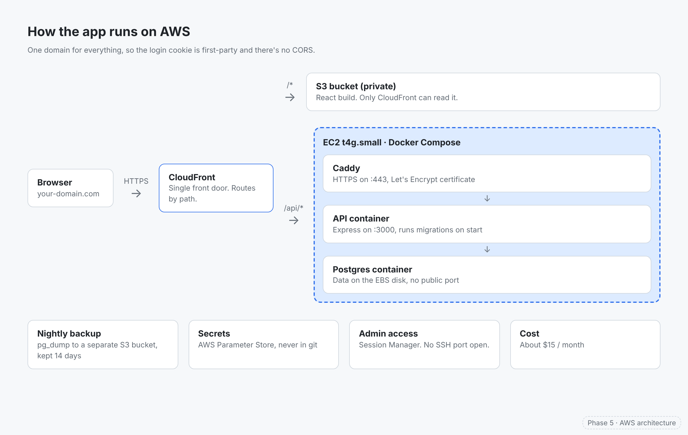

# Phase 5: Deploy to AWS + README

**Goal:** the app runs on AWS at a public HTTPS URL, and the README lets anyone run it locally or redeploy it.

## Summary (1-2 min read)

**What you get:** the app live on AWS at an HTTPS URL, plus a README that explains what it is, how to run it locally in a few minutes, how it's built, and how to redeploy.

**How it's built:**

- CloudFront is the single front door. It serves the React app from a private S3 bucket and forwards `/api/*` to the server, so the login cookie just works with no cross-site setup.
- One EC2 instance (t4g.small) runs the API, Postgres and Caddy (for HTTPS) in Docker, the same way it runs locally.
- Only ports 80 and 443 are open. Admin access uses AWS Session Manager instead of SSH, and secrets live in AWS Parameter Store, not in git.
- A nightly database backup goes to S3, kept for 14 days.
- Two scripts deploy the frontend and backend. Automatic deploys from GitHub can come later.
- Cost is about $19 a month.

**Deliberately not included:** autoscaling, managed database (RDS), multiple regions, zero-downtime deploys, Terraform.

**Decisions (confirmed by Nick):** app at `ajaia.nickesqueda.com`, server at `api.ajaia.nickesqueda.com`, region `us-east-2`, DNS records added by Nick outside AWS, Nick runs the AWS steps from [docs/deploy/aws-setup.md](../deploy/aws-setup.md).

---

## Scope

S3 + CloudFront for the frontend, one EC2 instance running the API and Postgres in Docker, HTTPS, secrets handling, nightly database backup, deploy script, README.

## Out of scope

Autoscaling, RDS, multi-region, blue/green deploys. Easy to add later; not worth it at this size.

## Architecture

```text
                         ┌───────────────────────────── AWS ─────────────────────────────┐
                         │                                                               │
 Browser ──HTTPS──▶  CloudFront (one domain)                                            │
                         │   ├─ /*      ─▶ S3 bucket (private, OAC)   React build        │
                         │   └─ /api/*  ─▶ EC2 t4g.small ──────────────────────────┐    │
                         │                 │ Caddy :443 (TLS, Let's Encrypt)       │    │
                         │                 │   └▶ api container (Express :3000)    │    │
                         │                 │        └▶ postgres container (EBS vol)│    │
                         │                 └───────────────────────────────────────┘    │
                         │                         nightly pg_dump ─▶ S3 backups bucket │
                         └───────────────────────────────────────────────────────────────┘
```

**Why one CloudFront domain for both:** the session cookie is first-party, there's no CORS to configure, and it matches local dev (Vite proxies `/api`).

## Details

**CloudFront**

- `/api/*` behavior: caching disabled, all HTTP methods, forwards cookies, query strings and the `Content-Type` header.
- SPA routing: a small CloudFront Function rewrites non-`/api`, non-file paths (like `/d/123`) to `/index.html`. We avoid "custom error page → index.html" because it would also turn real API 404s into HTML.
- Hashed asset files cached for a year; `index.html` not cached.

**EC2**

- t4g.small (2 vCPU, 2 GB, ARM), Amazon Linux 2023, 20 GB gp3 disk. Docker + Compose.
- `docker-compose.prod.yml`: `caddy`, `api`, `postgres`. Postgres has no public port.
- Security group: 443 from CloudFront's IP ranges only (AWS managed prefix list), 80 open for certificate renewal. No SSH port: shell access through SSM Session Manager.
- CloudFront sends a secret `X-Origin-Verify` header to the server. Caddy refuses anything without it with a 403, so the API can't be reached around CloudFront.
- Secrets (`SESSION_SECRET`, DB password) in SSM Parameter Store, pulled into the containers at start. Nothing secret in git.
- Migrations run automatically when the API container starts. The seed runs once, with production passwords taken from Parameter Store.
- Nightly `pg_dump` to an S3 bucket via cron, kept 14 days.

**Deploy**

- `scripts/deploy-frontend.sh`: build → `aws s3 sync` → CloudFront invalidation of `/index.html`.
- `scripts/deploy-backend.sh`: `git archive HEAD` → S3 → SSM command on the instance → download, `docker compose up -d --build`, wait for the API. The instance never needs GitHub access.
- GitHub Actions can run both on merge to `main` later. Manual scripts first.

**Cost:** about $19/month (EC2 ≈ $12, public IPv4 ≈ $3.60, EBS ≈ $1.60, S3 + CloudFront ≈ $1 at this traffic).

## README outline

1. What it is (one paragraph + screenshot)
2. Features, and **supported upload types: `.txt`, `.md` (max 1 MB)**
3. Run locally: `cp .env.example .env && docker compose up`, demo logins
4. Architecture (diagram above) and key decisions (Tiptap JSON storage, access model, 404-for-no-access, version conflicts)
5. Running tests
6. Deploying to AWS (step-by-step, links to the scripts)
7. Known limitations: no real-time co-editing, single access level, seeded users only, `.docx` not yet supported

## Wireframes

Rendered mockups. The layout and wording are what I'll build; colors and spacing may shift slightly.

**AWS architecture (no new screens in this phase)**



## Decisions

- **Domain:** app at `ajaia.nickesqueda.com` (CNAME to CloudFront). Server at `api.ajaia.nickesqueda.com` (A record to the Elastic IP), used only by CloudFront. DNS is outside AWS, so Nick adds three records.
- **Region:** `us-east-2`. The CloudFront certificate is in `us-east-1`, because CloudFront requires that.
- **Infrastructure as code:** no Terraform. Copy-paste CLI steps in [docs/deploy/aws-setup.md](../deploy/aws-setup.md), which Nick runs.
- **Demo password in production:** generated during setup and stored only in Parameter Store.

## Acceptance criteria

Run against the production URL:

- [ ] `curl -sI https://<domain>/` → 200, `text/html`; `curl -sI https://<domain>/d/anything` → 200 `index.html` (deep link works)
- [ ] `curl -s https://<domain>/api/does-not-exist` → JSON 404, not HTML
- [ ] `curl -i -X POST https://<domain>/api/auth/login …` → `Set-Cookie` with `Secure; HttpOnly; SameSite=Lax`
- [ ] The Phase 1-4 Playwright suite passes with `BASE_URL=https://<domain>`
- [ ] `nc -zv <ec2-ip> 5432` and `nc -zv <ec2-ip> 22` → refused/timeout; only 80/443 open
- [ ] `curl -sI https://api.ajaia.nickesqueda.com/api/auth/me` from outside AWS → timeout (443 only accepts CloudFront)
- [ ] `aws ssm send-command … "sudo reboot"`, wait, then the Playwright smoke test passes again and earlier docs are still there
- [ ] `aws s3 ls s3://<backup-bucket>/` shows a dump from the last 24 h; restoring it into a scratch Postgres container succeeds and row counts match
- [ ] `git grep -nE "SESSION_SECRET=|PASSWORD="` finds only `.env.example` placeholders
- [ ] Fresh clone in a clean container, following only the README → app running locally and alice can log in
